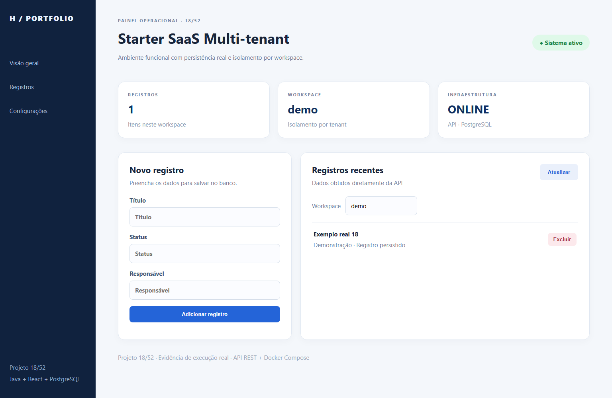

# Projeto 18/52 — Starter SaaS Multi-tenant

Aplicação full-stack para portfólio com Java 25, Spring Boot 3.5.7, React 19 e PostgreSQL 17.

## Execução

```powershell
docker compose up -d --build
```

Frontend: http://localhost:5178 · API: http://localhost:8188/api/health

## API

- `GET /api/health` — health check
- `GET /api/entries` — listagem isolada por workspace
- `POST /api/entries` — criação validada
- `DELETE /api/entries/{id}` — exclusão isolada por workspace

O header `X-Tenant` seleciona o workspace. **Não é autenticação**: esta implementação é uma demonstração local; para exposição pública, adicionar autenticação, autorização e isolamento por identidade validada no servidor.

## Evidência real



A captura é gerada pelo Playwright após gravar um registro real pela API via interface.

## Testes

`mvn -f backend/pom.xml clean verify` (Java 25) ou build Docker, que executa `clean verify`.

## Limitações

MVP de portfólio. Não inclui integração com corretora, LLM externo ou autenticação pronta para produção.
